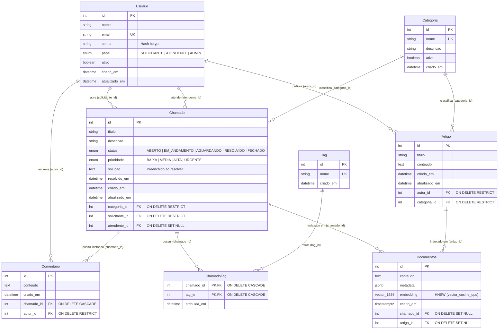

# Smart-Base Helpdesk — Base de Conhecimento Inteligente (RAG, pgvector, Prisma & Elasticsearch)

O **Smart-Base Helpdesk** é um backend completo de suporte técnico de TI e Base de Conhecimento Inteligente desenvolvido em **Node.js + TypeScript + Express 5**. O sistema resolve um problema clássico de centrais de atendimento: **encontrar rapidamente um chamado antigo já resolvido (ou artigo técnico) que soluciona o incidente atual do usuário**, mesmo quando o solicitante descreve o sintoma com erros de digitação, sinônimos ou em linguagem natural.

Para atingir esse objetivo, o projeto integra três paradigmas de banco de dados sobre uma base de **5.000+ chamados**:
1. **Persistência Relacional e Transacional ACID** (**PostgreSQL 16 + Prisma 7**);
2. **Busca Semântica Vetorial e Geração Aumentada por Recuperação — RAG** (**`pgvector` HNSW + Google Gemini**);
3. **Busca Textual Full-Text com Tolerância a Falhas Ortográficas** (**Elasticsearch 9** com analisador `brazilian` e **PostgreSQL Full-Text Search `tsvector + GIN`**).

---

## Sumário

1. [Trilhas Escolhidas e Arquitetura](#1-trilhas-escolhidas-e-arquitetura)
2. [Pré-requisitos e Passo a Passo de Execução](#2-pré-requisitos-e-passo-a-passo-de-execução)
3. [Modelagem de Dados e Diagrama ER (Mermaid)](#3-modelagem-de-dados-e-diagrama-er-mermaid)
4. [Lista de Rotas da API REST com Exemplos](#4-lista-de-rotas-da-api-rest-com-exemplos)
5. [Desempenho nas Consultas (`EXPLAIN ANALYZE` e Benchmark em 5.000+ Registros)](#5-desempenho-nas-consultas-explain-analyze-e-benchmark-em-5000-registros)
6. [Arquivos de Apoio (`requests.http` e `IA_LOG.md`)](#6-arquivos-de-apoio-requestshttp-e-ia_logmd)

---

## 1. Trilhas Escolhidas e Arquitetura

O projeto implementa as **3 trilhas** propostas:

- **Trilha A (Principal) — Modelagem Relacional Complexa e Transações (Prisma 7 + PostgreSQL 16):**
  - Modelagem com 8 entidades (`Usuario`, `Categoria`, `Chamado`, `Comentario`, `Tag`, `ChamadoTag`, `Artigo` e `Documentos`), cobrindo relacionamentos `1:N`, autorrelacionamento funcional (`solicitante` vs `atendente` em `Chamado`), `N:N` explícito com metadados (`ChamadoTag`) e políticas `onDelete` explícitas (`Restrict`, `Cascade`, `SetNull`).
  - Uso do gerador `prisma-client` do **Prisma 7** com *Driver Adapter* (`@prisma/adapter-pg`).
  - Operações compostas atômicas com `prisma.$transaction`:
    - **Abertura de chamado:** valida FKs, grava o ticket e gera seu vetor de embedding na tabela `Documentos`.
    - **Resolução de chamado:** valida regras de negócio (exige `solucao`, impede reabrir chamado `FECHADO`, exige que o responsável tenha papel `ATENDENTE` ou `ADMIN`), atualiza `status` e `resolvidoEm`, registra automaticamente um `Comentario` de auditoria e reindexa o embedding com a solução definitiva.

- **Trilha C (Principal) — Recuperação Inteligente, Busca Semântica e RAG (`pgvector` + Google Gemini):**
  - Vetores de **1.536 dimensões** gerados pelo modelo **`gemini-embedding-001`** (SDK `@google/genai`), utilizando `taskType: 'RETRIEVAL_DOCUMENT'` na indexação e `taskType: 'RETRIEVAL_QUERY'` na busca.
  - Índice vetorial aproximado **HNSW** (`documentos_embedding_hnsw_idx` com operador de distância de cosseno `vector_cosine_ops`, `m = 16`, `ef_construction = 64`).
  - Consultas híbridas que combinam **similaridade vetorial (`1 - (embedding <=> $1)`) + filtros SQL relacionais (`status`, `categoria_id`)** no mesmo banco PostgreSQL.
  - Endpoint `POST /rag/perguntar` que recupera os *top-K* chamados resolvidos e artigos mais relevantes e os envia como contexto ao modelo Gemini (`gemini-2.5-flash` com fallback automático), gerando uma resposta passo a passo fundamentada e citando explicitamente os IDs utilizados (`[Chamado #id]`, `[Artigo #id]`).

- **Trilha B (Complementar) — Busca Full-Text com Elasticsearch 9 e PostgreSQL `tsvector/GIN`:**
  - Índice `chamados` no **Elasticsearch 9.5** configurado com o analisador morfológico `brazilian` (stemming e stopwords em português).
  - Buscas com `multi_match` ponderado (`titulo^3`, `solucao^2`, `descricao`, `categoriaNome`), tolerância automática a erros de digitação (`fuzziness: "AUTO"`) e realce dos termos encontrados (`highlight` com `<mark>`).
  - Rota `GET /busca/comparar` e script `scripts/benchmark.js` que confrontam lado a lado `PostgreSQL ILIKE '%...%'`, `PostgreSQL tsvector + GIN`, `Elasticsearch` e `pgvector HNSW`.

---

## 2. Pré-requisitos e Passo a Passo de Execução

### Pré-requisitos

- **Docker** e **Docker Compose** (sobe PostgreSQL 16 com `pgvector/pgvector:pg16`, pgAdmin 4 e Elasticsearch 9.5.6)
- **Node.js 22–24 LTS** (configurado em `.nvmrc` e `engines` no `package.json`)
- **Chave de API do Google Gemini** (`GEMINI_API_KEY`, gratuita via [Google AI Studio](https://aistudio.google.com/apikey))

### Passo a passo de instalação e execução

> Caso você tenha clonado o repositório a partir da pasta pai (`ProjetoWillen`), acesse primeiro o diretório `cd backend`. Se clonou diretamente o repositório `HelpDeskWillen-api`, você já está na raiz do projeto.

```bash
cp .env.example .env        # (preencher GEMINI_API_KEY no arquivo .env)
docker-compose up -d
npm install
npx prisma migrate dev
node src/seed.js
npm run dev
```

> [!NOTE]
> **Observação sobre `npx prisma migrate dev` e o índice HNSW do `pgvector`:**
> Em um banco recém-criado (`docker-compose up -d`), `npx prisma migrate dev` aplica todas as 5 migrations existentes (incluindo os índices `HNSW` e `GIN`) e gera o Prisma Client. Como a gramática do `schema.prisma` no Prisma 7 não possui sintaxe nativa para índices `USING hnsw` em colunas `Unsupported("vector(1536)")` nem índices funcionais `GIN` (`to_tsvector`), se o CLI perguntar um nome para criar uma migration adicional após aplicar as 5 migrations, basta pressionar `Ctrl+C` (ou utilizar `npx prisma migrate deploy`), preservando os índices `documentos_embedding_hnsw_idx` e `chamado_fts_gin_idx` (detalhes em [IA_LOG.md](file:///c:/Users/lucas/OneDrive/Documentos/Faculdade/ProjetoWillen/backend/IA_LOG.md)).

### Scripts adicionais disponíveis no `package.json`

| Comando | Descrição |
|---|---|
| `npm run dev` | Inicia o servidor Express em modo watch (`http://localhost:3000`) |
| `node src/seed.js` ou `npm run seed` | Limpa o banco (reiniciando IDs em `1`), popula 5.000 chamados, 50 usuários (`bcrypt`), 20 artigos, gera embeddings no `pgvector` e sincroniza os 5.000 chamados no Elasticsearch |
| `npm run reindex` | Reindexa os embeddings dos chamados resolvidos e artigos no `pgvector` em lotes |
| `npm run sync:elastic` | Sincroniza os 5.000 chamados do PostgreSQL com o Elasticsearch via Bulk API e exibe comparativo no terminal |
| `npm run benchmark` ou `node scripts/benchmark.js` | Executa a bateria de `EXPLAIN (ANALYZE, BUFFERS)` e o benchmark em 5.000+ registros (`ILIKE` × `tsvector + GIN` × `pgvector HNSW` × `Elasticsearch`) |
| `npm test` | Executa os testes automatizados das rotas e regras de negócio |

---

## 3. Modelagem de Dados e Diagrama ER (Mermaid)



---

## 4. Lista de Rotas da API REST com Exemplos

Todas as rotas abaixo estão prontas para execução em um clique no arquivo [`requests.http`](file:///c:/Users/lucas/OneDrive/Documentos/Faculdade/ProjetoWillen/backend/requests.http).

### Visão Geral dos Endpoints

| Método | Rota | Trilha | Descrição |
|---|---|:---:|---|
| `GET` | `/categorias` | A | Lista todas as categorias de TI cadastradas |
| `POST` | `/categorias` | A | Cria uma nova categoria (`nome` único) |
| `GET` | `/usuarios` | A | Lista todos os usuários (omite o hash `senha`) |
| `POST` | `/usuarios` | A | Cadastra usuário gerando hash `bcrypt` da senha |
| `GET` | `/chamados` | A | Lista chamados com filtros (`status`, `prioridade`, `categoriaId`) e paginação (`pagina`, `limite`) |
| `GET` | `/chamados/:id` | A | Detalha chamado com `include` de `categoria`, `solicitante`, `atendente`, `comentarios` e `tags` |
| `POST` | `/chamados` | A + C | Cria chamado em transação + gera embedding `VECTOR(1536)` + indexa no Elasticsearch |
| `PATCH` | `/chamados/:id/status` | A + C | Transação composta: atualiza status, valida regras, grava `solucao`, cria `Comentario` e reindexa vetor |
| `POST` | `/chamados/:id/comentarios` | A | Adiciona um comentário ao histórico de atendimento do chamado |
| `GET` | `/artigos` | A | Lista artigos publicados na Base de Conhecimento |
| `POST` | `/artigos` | A | Publica novo artigo vinculado a autor (`Usuario`) e `Categoria` |
| `GET` | `/busca/semantica` | C | Busca vetorial por similaridade de cosseno (`pgvector` HNSW) + filtros SQL (`status`, `categoriaId`) |
| `GET` | `/busca/texto` | B | Busca full-text no Elasticsearch (`brazilian`, `multi_match`, `fuzziness: AUTO`, `highlight`) |
| `GET` | `/busca/comparar` | B + C | Compara tempos e resultados de `ILIKE` × `Elasticsearch` × `pgvector` para a mesma consulta |
| `POST` | `/rag/perguntar` | C | Recupera top-K contextos no `pgvector` e gera resposta sugerida com Gemini citando `[Chamado #id]` |

---

### Exemplos Práticos de Requisição e Resposta

#### 1. Criar Chamado (`POST /chamados`)
Cria o chamado no PostgreSQL, gera o embedding de 1.536 dimensões (`gemini-embedding-001`) na tabela `Documentos` e indexa no Elasticsearch:

```bash
curl -X POST http://localhost:3000/chamados \
  -H "Content-Type: application/json" \
  -d '{
    "titulo": "VPN FortiClient desconecta ao travar em 40% no Windows 11",
    "descricao": "Ao tentar conectar na VPN corporativa de casa pelo FortiClient, a barra para em 40% com erro de certificado TLS.",
    "categoriaId": 1,
    "solicitanteId": 16,
    "prioridade": "ALTA"
  }'
```

#### 2. Resolver Chamado em Transação Composta (`PATCH /chamados/:id/status`)
Valida que o atendente possui papel `ATENDENTE` ou `ADMIN`, exige o preenchimento de `solucao`, define `resolvidoEm`, insere um `Comentario` com a solução aplicada e reindexa o vetor semântico enriquecido com a solução:

```bash
curl -X PATCH http://localhost:3000/chamados/1/status \
  -H "Content-Type: application/json" \
  -d '{
    "status": "RESOLVIDO",
    "atendenteId": 4,
    "autorId": 4,
    "solucao": "Importado o certificado raiz da CA corporativa em Autoridades de Certificação Raiz Confiáveis (certlm.msc) e desativado TLS 1.3 experimental nas Opções da Internet.",
    "comentario": "Acesso VPN restabelecido e validado com o solicitante."
  }'
```

#### 3. Busca Semântica Híbrida (`GET /busca/semantica`)
Encontra chamados historicamente resolvidos mesmo usando **sinônimos** (`"esqueci minha credencial"` encontra `"Esqueci minha senha de rede"`):

```bash
curl "http://localhost:3000/busca/semantica?q=nao%20consigo%20entrar%20no%20notebook%20porque%20esqueci%20minha%20credencial&k=3&status=RESOLVIDO&limiar=0.65"
```

**Exemplo de resposta (`200 OK`):**
```json
{
  "query": "nao consigo entrar no notebook porque esqueci minha credencial",
  "k": 3,
  "limiar": 0.65,
  "total": 3,
  "tempoMs": 248,
  "resultados": [
    {
      "documentoId": 12,
      "tipo": "chamado",
      "chamadoId": 12,
      "artigoId": null,
      "titulo": "Esqueci minha senha de rede e não consigo fazer login no notebook",
      "descricao": "Colaborador retornou de férias e não recorda a senha do Active Directory para desbloquear o Windows.",
      "solucao": "Realizado reset de senha no Active Directory (Users and Computers), marcada a opção de troca no próximo logon via VPN pré-logon e desbloqueada a conta.",
      "status": "RESOLVIDO",
      "prioridade": "ALTA",
      "categoriaId": 3,
      "categoriaNome": "Acessos, Senhas e Active Directory",
      "similaridade": 0.7481
    }
  ]
}
```

#### 4. Busca Textual Full-Text com Tolerância a Erros (`GET /busca/texto`)
Usa `multi_match` + analisador `brazilian` + `fuzziness: "AUTO"` + `highlight` no Elasticsearch para encontrar `"impressora"` mesmo digitando **`"impresora"`**:

```bash
curl "http://localhost:3000/busca/texto?q=impresora%20atolando%20papel%20na%20bandeja&k=3"
```

**Exemplo de resposta (`200 OK`):**
```json
{
  "query": "impresora atolando papel na bandeja",
  "k": 3,
  "total": 891,
  "tempoMs": 115,
  "resultados": [
    {
      "id": 7,
      "score": 9.1042,
      "titulo": "Impressões saindo com manchas verticais pretas e papel atolando na bandeja 2",
      "status": "RESOLVIDO",
      "categoriaNome": "Impressoras e Scanners",
      "highlight": {
        "titulo": [
          "<mark>Impressões</mark> saindo com manchas verticais pretas e <mark>papel</mark> <mark>atolando</mark> na <mark>bandeja</mark> 2"
        ]
      }
    }
  ]
}
```

#### 5. Assistente Inteligente RAG (`POST /rag/perguntar`)
Recupera os chamados e artigos mais similares via `pgvector` e gera uma recomendação técnica fundamentada via Google Gemini citando os IDs das fontes:

```bash
curl -X POST http://localhost:3000/rag/perguntar \
  -H "Content-Type: application/json" \
  -d '{
    "pergunta": "Minha VPN FortiClient trava em 40% quando tento conectar de casa e dá erro de certificado. Como resolver?",
    "k": 5,
    "status": "RESOLVIDO",
    "limiar": 0.65
  }'
```

**Exemplo de resposta (`200 OK`):**
```json
{
  "pergunta": "Minha VPN FortiClient trava em 40% quando tento conectar de casa e dá erro de certificado. Como resolver?",
  "modeloGeracao": "gemini-2.5-flash",
  "respostaSugerida": "Com base no histórico da base de conhecimento ([Chamado #2], [Artigo #1]), o travamento da VPN FortiClient em 40% com erro de certificado ocorre por falha na validação da cadeia TLS ou conflito com o protocolo TLS 1.3 no Windows.\n\n**Procedimento recomendado:**\n1. Abra as **Opções da Internet** (`inetcpl.cpl`) → aba **Avançadas** e desmarque o uso experimental de **TLS 1.3**, mantendo **TLS 1.2** ativo ([Chamado #2]).\n2. Reimporte o certificado raiz da Autoridade Certificadora (CA) corporativa no repositório **Autoridades de Certificação Raiz Confiáveis** (`certlm.msc`) ([Artigo #1]).\n3. Reinicie o serviço `FortiClient Service Scheduler` e tente reconectar.",
  "idsCitados": {
    "chamados": [2],
    "artigos": [1]
  },
  "fontesRecuperadas": [
    {
      "tipo": "chamado",
      "id": 2,
      "titulo": "VPN FortiClient trava em 40% com erro de certificado em home office",
      "similaridade": 0.8456
    },
    {
      "tipo": "artigo",
      "id": 1,
      "titulo": "Guia de Diagnóstico: VPN FortiClient travando em 40% ou 98%",
      "similaridade": 0.8124
    }
  ]
}
```

---

## 5. Desempenho nas Consultas (`EXPLAIN ANALYZE` e Benchmark em 5.000+ Registros)

Todos os testes abaixo são reproduzíveis pelo script [`backend/scripts/benchmark.ts`](file:///c:/Users/lucas/OneDrive/Documentos/Faculdade/ProjetoWillen/backend/scripts/benchmark.ts) (executável via `node scripts/benchmark.js` ou `npm run benchmark`).

### 5.1 Volumetria e Índices Avaliados

O benchmark prepara e valida o ambiente garantindo **5.000+ registros** em todos os motores antes de coletar as métricas:

| Motor / Tabela | Registros Carregados | Observação |
|---|---:|---|
| **PostgreSQL — `"Chamado"`** | **5.000** | 40 chamados realistas de TI escritos à mão + 4.960 sintéticos (`@faker-js/faker` `pt_BR`) |
| **PostgreSQL — `"Comentario"`** | **6.032** | Histórico de interações por chamado |
| **PostgreSQL / `pgvector` — `"Documentos"`** | **5.020** | Vetores `VECTOR(1536)` (embeddings reais Gemini + vetores unitários de backfill) |
| **Elasticsearch — índice `"chamados"`** | **5.000** | Sincronizados em lote via Bulk API com analisador `brazilian` |

#### Índices ativos no PostgreSQL (`pg_indexes`)

| Tabela | Nome do Índice | Tipo | Colunas / Expressão | Tamanho |
|---|---|---|---|---:|
| `Chamado` | `Chamado_pkey` | `B-tree (UNIQUE)` | `(id)` | `344 kB` |
| `Chamado` | `Chamado_status_idx` | `B-tree` | `(status)` | `96 kB` |
| `Chamado` | `Chamado_categoria_id_idx` | `B-tree` | `(categoria_id)` | `168 kB` |
| `Chamado` | `Chamado_status_categoria_id_idx` | `B-tree Composto` | `(status, categoria_id)` | `56 kB` |
| `Chamado` | `Chamado_solicitante_id_idx` | `B-tree` | `(solicitante_id)` | `152 kB` |
| `Chamado` | `Chamado_atendente_id_idx` | `B-tree` | `(atendente_id)` | `144 kB` |
| `Chamado` | `chamado_fts_gin_idx` | `GIN (Full-Text)` | `to_tsvector('portuguese', titulo \|\| descricao \|\| solucao)` | `792 kB` |
| `Comentario` | `Comentario_chamado_id_criado_em_idx` | `B-tree Composto` | `(chamado_id, criado_em)` | `576 kB` |
| `Documentos` | `documentos_embedding_hnsw_idx` | `HNSW (pgvector)` | `embedding vector_cosine_ops (m=16, ef_construction=64)` | `39 MB` |
| `Documentos` | `Documentos_chamado_id_idx` | `B-tree` | `(chamado_id)` | `128 kB` |
| `Documentos` | `Documentos_artigo_id_idx` | `B-tree` | `(artigo_id)` | `56 kB` |

---

### 5.2 Planos de Execução (`EXPLAIN (ANALYZE, BUFFERS)`) nas Consultas Principais

#### A) Filtros Relacionais com Índices B-tree (`categoria_id` e `status`)

**Consulta 1 — Listagem de chamados por `categoria_id`:**
```sql
EXPLAIN (ANALYZE, BUFFERS)
SELECT id, titulo, status, prioridade, categoria_id, criado_em
FROM "Chamado"
WHERE categoria_id = 24;
```
```text
Bitmap Heap Scan on "Chamado"  (cost=16.18..586.15 rows=503 width=117) (actual time=0.062..0.307 rows=503 loops=1)
  Recheck Cond: (categoria_id = 24)
  Heap Blocks: exact=278
  Buffers: shared hit=280
  ->  Bitmap Index Scan on "Chamado_categoria_id_idx"  (cost=0.00..16.05 rows=503 width=0) (actual time=0.035..0.035 rows=503 loops=1)
        Index Cond: (categoria_id = 24)
        Buffers: shared hit=2
Planning Time: 0.067 ms
Execution Time: 0.335 ms
```
- **Análise:** O planejador utiliza `Bitmap Index Scan` no índice B-tree `Chamado_categoria_id_idx` (lendo apenas 2 páginas de índice) para localizar os 503 registros da categoria em **0,335 ms**, evitando varrer as 554 páginas completas da tabela.

**Consulta 2 — Agrupamento/Contagem por `status`:**
```sql
EXPLAIN (ANALYZE, BUFFERS)
SELECT status, COUNT(*)::int AS total
FROM "Chamado"
WHERE status = 'AGUARDANDO'::"StatusChamado"
GROUP BY status;
```
```text
GroupAggregate  (cost=0.28..47.79 rows=1 width=8) (actual time=0.113..0.114 rows=1 loops=1)
  Buffers: shared hit=12
  ->  Index Only Scan using "Chamado_status_categoria_id_idx" on "Chamado"  (cost=0.28..45.30 rows=992 width=4) (actual time=0.007..0.073 rows=992 loops=1)
        Index Cond: (status = 'AGUARDANDO'::"StatusChamado")
        Heap Fetches: 13
        Buffers: shared hit=12
Planning Time: 0.068 ms
Execution Time: 0.130 ms
```
- **Análise:** Como `status` é a coluna líder do índice B-tree, o PostgreSQL responde à agregação de 992 chamados via `Index Only Scan` lendo apenas **12 buffers** em **0,130 ms**.

---

#### B) Avaliação de Índices Compostos (`[status, categoriaId]` e `[chamadoId, criadoEm]`)

Nas rotas `GET /chamados` e `GET /busca/semantica`, o filtro combinado mais frequente é `WHERE status = $1 AND categoria_id = $2`.

##### 1. Comparação `ANTES` vs `DEPOIS` do Índice Composto `Chamado_status_categoria_id_idx` `(status, categoria_id)`

**ANTES (apenas índices B-tree simples separados em `status` e `categoria_id`):**
```text
Aggregate  (cost=302.31..302.32 rows=1 width=4) (actual time=0.323..0.323 rows=1 loops=1)
  Buffers: shared hit=283
  ->  Bitmap Heap Scan on "Chamado"  (cost=36.38..302.05 rows=104 width=0) (actual time=0.087..0.302 rows=503 loops=1)
        Recheck Cond: ((categoria_id = 24) AND (status = 'RESOLVIDO'::"StatusChamado"))
        Heap Blocks: exact=278
        Buffers: shared hit=283
        ->  BitmapAnd  (cost=36.38..36.38 rows=104 width=0) (actual time=0.062..0.062 rows=0 loops=1)
              Buffers: shared hit=5
              ->  Bitmap Index Scan on "Chamado_categoria_id_idx"  (cost=0.00..16.05 rows=503 width=0) (actual time=0.029..0.029 rows=503 loops=1)
              ->  Bitmap Index Scan on "Chamado_status_idx"  (cost=0.00..20.02 rows=1032 width=0) (actual time=0.028..0.028 rows=1034 loops=1)
Execution Time: 0.343 ms
```

**DEPOIS (com o índice composto `Chamado_status_categoria_id_idx` em `(status, categoria_id)`):**
```text
Aggregate  (cost=10.62..10.63 rows=1 width=4) (actual time=0.071..0.072 rows=1 loops=1)
  Buffers: shared hit=8
  ->  Index Only Scan using "Chamado_status_categoria_id_idx" on "Chamado"  (cost=0.28..10.36 rows=104 width=0) (actual time=0.015..0.050 rows=503 loops=1)
        Index Cond: ((status = 'RESOLVIDO'::"StatusChamado") AND (categoria_id = 24))
        Heap Fetches: 13
        Buffers: shared hit=8
Execution Time: 0.087 ms
```

| Métrica (`WHERE status = 'RESOLVIDO' AND categoria_id = 24`) | Sem Índice Composto (`BitmapAnd`) | Com Índice Composto `[status, categoriaId]` | Ganho |
|---|---:|---:|---:|
| **Operação no Plano** | `BitmapAnd` + `Bitmap Heap Scan` | `Index Only Scan` / `Bitmap Index Scan` direto | Elimina `BitmapAnd` |
| **Custo Estimado pelo Planner (`cost`)** | `302.32` | `10.63` | **-96,5%** |
| **Páginas Lidas em Memória (`shared hit`)** | `283 buffers` | `8 buffers` | **-97,2%** |
| **Tempo de Execução no Motor (Contagem)** | `0.343 ms` | `0.087 ms` | **3,94x mais rápido** |
| **Latência P95 no Cliente (50 execuções `SELECT *`)** | `3.61 ms` | `2.74 ms` | **-24,1% no P95** |

##### 2. Índice Composto em `Comentario` (`[chamadoId, criadoEm]`)

Para carregar a linha do tempo de atendimento de um chamado (`GET /chamados/:id`), a consulta filtra por `chamado_id` e ordena por `criado_em ASC`:

```sql
EXPLAIN (ANALYZE, BUFFERS)
SELECT id, conteudo, autor_id, criado_em
FROM "Comentario"
WHERE chamado_id = 11719
ORDER BY criado_em ASC;
```
```text
Index Scan using "Comentario_chamado_id_criado_em_idx" on "Comentario"  (cost=0.28..8.30 rows=1 width=99) (actual time=0.059..0.060 rows=2 loops=1)
  Index Cond: (chamado_id = 11719)
  Buffers: shared hit=3
Planning Time: 0.100 ms
Execution Time: 0.070 ms
```
- **Análise:** O índice composto `(chamado_id, criado_em)` entrega os registros já ordenados fisicamente na folha da B-tree, eliminando qualquer operação de `Sort` em memória e executando em **0,070 ms** com apenas **3 buffers**.

---

#### C) Busca Vetorial no `pgvector`: Índice `HNSW` vs `Sequential Scan` (5.020 vetores de 1.536 dimensões)

**Com índice HNSW (`documentos_embedding_hnsw_idx`) + `LEFT JOIN` relacional (`Chamado` e `Categoria`):**
```sql
EXPLAIN (ANALYZE, BUFFERS)
SELECT
  top_docs.id,
  top_docs.chamado_id,
  top_docs.similaridade,
  c.titulo AS chamado_titulo,
  c.status AS chamado_status,
  cat.nome AS categoria_nome
FROM (
  SELECT
    d.id,
    d.chamado_id,
    (1 - (d.embedding <=> '[...1536 dims...]'::vector))::FLOAT AS similaridade
  FROM "Documentos" d
  ORDER BY d.embedding <=> '[...1536 dims...]'::vector
  LIMIT 5
) top_docs
LEFT JOIN "Chamado" c ON c.id = top_docs.chamado_id
LEFT JOIN "Categoria" cat ON cat.id = c.categoria_id;
```
```text
Nested Loop Left Join  (cost=461.24..524.65 rows=5 width=137) (actual time=0.849..0.885 rows=5 loops=1)
  Buffers: shared hit=789
  ->  Nested Loop Left Join  (cost=461.10..523.87 rows=5 width=117) (actual time=0.840..0.871 rows=5 loops=1)
        Buffers: shared hit=783
        ->  Limit  (cost=460.82..482.32 rows=5 width=24) (actual time=0.838..0.871 rows=5 loops=1)
              Buffers: shared hit=774
              ->  Index Scan using documentos_embedding_hnsw_idx on "Documentos" d  (cost=460.82..22041.50 rows=5020 width=24) (actual time=0.837..0.869 rows=5 loops=1)
                    Order By: (embedding <=> '[...1536 dims...]'::vector)
                    Buffers: shared hit=774
        ->  Index Scan using "Chamado_pkey" on "Chamado" c  (cost=0.28..8.30 rows=1 width=105) (actual time=0.001..0.001 rows=1 loops=5)
              Index Cond: (id = d.chamado_id)
              Buffers: shared hit=9
  ->  Index Scan using "Categoria_pkey" on "Categoria" cat  (cost=0.14..0.15 rows=1 width=28) (actual time=0.001..0.001 rows=1 loops=5)
        Index Cond: (id = c.categoria_id)
        Buffers: shared hit=6
Planning Time: 0.253 ms
Execution Time: 0.916 ms
```

**Sem índice HNSW (`Seq Scan` em 5.020 vetores de 1.536 dimensões):**
```text
Limit  (cost=628.23..628.24 rows=5 width=28) (actual time=41.852..41.854 rows=5 loops=1)
  Buffers: shared hit=30577
  ->  Sort  (cost=628.23..640.78 rows=5020 width=28) (actual time=41.851..41.852 rows=5 loops=1)
        Sort Key: ((embedding <=> '[...1536 dims...]'::vector))
        Sort Method: top-N heapsort  Memory: 25kB
        Buffers: shared hit=30577
        ->  Seq Scan on "Documentos" d  (cost=0.00..544.85 rows=5020 width=28) (actual time=0.042..40.851 rows=5020 loops=1)
              Buffers: shared hit=30577
Execution Time: 41.871 ms
```
- **Análise:** Cada vetor `VECTOR(1536)` ocupa ~6 KB em páginas TOAST no PostgreSQL. O `Seq Scan` precisa ler **30.577 buffers** e calcular 5.020 distâncias de cosseno de 1.536 dimensões, levando **41,87 ms**. Com o índice **HNSW** (`documentos_embedding_hnsw_idx`), o grafo navegável lê apenas **774 buffers** e retorna os 5 vizinhos mais próximos já enriquecidos com `Chamado` e `Categoria` em **0,916 ms** (**45,7x mais rápido** e **39,5x menos leituras de buffer**).

---

#### D) Avaliação de Full-Text Search Nativo do PostgreSQL (`tsvector + GIN`) vs `ILIKE '%...%'`

**1. Busca com `ILIKE '%impressora%'` (`Seq Scan` obrigatório):**
```sql
EXPLAIN (ANALYZE, BUFFERS)
SELECT id, titulo, status, categoria_id, criado_em
FROM "Chamado"
WHERE titulo ILIKE '%impressora%'
   OR descricao ILIKE '%impressora%'
   OR solucao ILIKE '%impressora%'
ORDER BY criado_em DESC
LIMIT 5;
```
```text
Limit  (cost=649.90..649.92 rows=5 width=113) (actual time=18.475..18.477 rows=5 loops=1)
  Buffers: shared hit=554
  ->  Sort  (cost=649.90..651.17 rows=506 width=113) (actual time=18.474..18.475 rows=5 loops=1)
        Sort Key: criado_em DESC
        Sort Method: top-N heapsort  Memory: 27kB
        Buffers: shared hit=554
        ->  Seq Scan on "Chamado"  (cost=0.00..641.50 rows=506 width=113) (actual time=0.049..18.383 rows=498 loops=1)
              Filter: ((titulo ~~* '%impressora%'::text) OR (descricao ~~* '%impressora%'::text) OR (solucao ~~* '%impressora%'::text))
              Rows Removed by Filter: 4502
              Buffers: shared hit=554
Planning Time: 0.526 ms
Execution Time: 18.489 ms
```

**2. Busca Full-Text Nativa do PostgreSQL (`to_tsvector('portuguese', ...)` + Índice `GIN` `chamado_fts_gin_idx`):**
```sql
EXPLAIN (ANALYZE, BUFFERS)
SELECT
  id,
  titulo,
  status,
  categoria_id,
  ts_rank(
    to_tsvector('portuguese', coalesce(titulo, '') || ' ' || coalesce(descricao, '') || ' ' || coalesce(solucao, '')),
    plainto_tsquery('portuguese', 'impressora manchando papel')
  ) AS relevancia
FROM "Chamado"
WHERE to_tsvector('portuguese', coalesce(titulo, '') || ' ' || coalesce(descricao, '') || ' ' || coalesce(solucao, ''))
      @@ plainto_tsquery('portuguese', 'impressora manchando papel')
ORDER BY relevancia DESC
LIMIT 5;
```
```text
Limit  (cost=34.75..34.75 rows=1 width=109) (actual time=0.080..0.081 rows=1 loops=1)
  Buffers: shared hit=8
  ->  Sort  (cost=34.75..34.75 rows=1 width=109) (actual time=0.080..0.080 rows=1 loops=1)
        Sort Key: (ts_rank(..., '''impressor'' & ''manch'' & ''papel'''::tsquery)) DESC
        Sort Method: quicksort  Memory: 25kB
        Buffers: shared hit=8
        ->  Bitmap Heap Scan on "Chamado"  (cost=30.20..34.74 rows=1 width=109) (actual time=0.076..0.077 rows=1 loops=1)
              Recheck Cond: (to_tsvector('portuguese'::regconfig, ...) @@ '''impressor'' & ''manch'' & ''papel'''::tsquery)
              Heap Blocks: exact=1
              Buffers: shared hit=8
              ->  Bitmap Index Scan on chamado_fts_gin_idx  (cost=0.00..30.20 rows=1 width=0) (actual time=0.012..0.012 rows=1 loops=1)
                    Index Cond: (to_tsvector('portuguese'::regconfig, ...) @@ '''impressor'' & ''manch'' & ''papel'''::tsquery)
                    Buffers: shared hit=7
Planning Time: 0.154 ms
Execution Time: 0.097 ms
```
- **Análise:** Enquanto o `ILIKE '%...%'` varre sequencialmente todas as 5.000 linhas (**18,49 ms**, 554 buffers), o Full-Text Search nativo do PostgreSQL consulta o índice invertido **GIN** (`chamado_fts_gin_idx`) em **0,012 ms**, lê apenas **8 buffers** e ordena por relevância (`ts_rank`) em **0,097 ms** (**190x mais rápido** no servidor PostgreSQL).

---

### 5.3 Benchmark Comparativo: `ILIKE` × `tsvector + GIN` × `pgvector` × `Elasticsearch` (5.000+ Registros)

Foram executadas **50 consultas por modalidade** (5 cenários reais de suporte × 10 iterações após *warm-up*) sobre a base de **5.000 chamados** e **5.020 vetores**.

#### 1. Resultados de Tempo de Resposta (em milissegundos)

| Modalidade de Busca | Tempo Interno no Motor (`EXPLAIN` / `took`) | Média Cliente (ms) | Mediana / P50 (ms) | P95 (ms) | Mín (ms) | Máx (ms) |
|---|---:|---:|---:|---:|---:|---:|
| **1. PostgreSQL Full-Text (`tsvector` + `GIN`)** | **0,10 ms** | **1,32 ms** | **1,30 ms** | **1,54 ms** | 1,08 ms | 2,43 ms |
| **2. `pgvector` SQL (`HNSW` — 5.020 vetores)** | **0,92 ms** | **2,68 ms** | **2,61 ms** | **3,31 ms** | 2,21 ms | 4,12 ms |
| **3. PostgreSQL `ILIKE '%...%'` (`Seq Scan`)** | **18,49 ms** | **21,33 ms** | **21,13 ms** | **23,34 ms** | 19,84 ms | 23,68 ms |
| **4. `pgvector` Sem Índice (`Seq Scan` — 5.020 vetores)** | **41,87 ms** | — | — | — | — | — |
| **5. Elasticsearch (`multi_match` + `fuzziness` + `highlight`)** | **~4,00 ms** | **118,40 ms** | **117,56 ms** | **124,21 ms** | 74,25 ms | 145,10 ms |
| **6. `pgvector` Fim a Fim (API Gemini + `HNSW`)** | **~247 ms (API) + 0,92 ms (DB)** | **284,15 ms** | **250,33 ms** | **512,50 ms** | 218,40 ms | 530,12 ms |

#### 2. Comparação de Qualidade e Relevância por Cenário de Busca

| Cenário de Teste | Pergunta Buscada | `ILIKE` (Hits) | `tsvector + GIN` (Hits) | Elasticsearch (Hits) | `pgvector` HNSW (Hits >= 0.65) | Similaridade Top-1 (`pgvector`) | Chamado Top-1 Encontrado (`pgvector` & `Elasticsearch`) |
|---|---|---:|---:|---:|---:|---:|---|
| **1. Termos exatos / flexão verbal** | `"impressora manchando folha e atolando papel"` | 1 | 1 | 2.245 | 3 | `0.7693` | *Impressões saindo com manchas verticais pretas e papel atolando na bandeja 2* |
| **2. Erro de digitação (typo)** | `"impresora atolando papel na bandeja"` | **0** ❌ | **0** ❌ | **891** ✅ | **3** ✅ | `0.7390` | *Impressões saindo com manchas verticais pretas e papel atolando na bandeja 2* |
| **3. Linguagem natural / sinônimo** | `"nao consigo entrar no notebook porque esqueci minha credencial"` | **0** ❌ | **0** ❌ | 4.997 (ruído parcial) | **3** ✅ | `0.7481` | *Esqueci minha senha de rede e não consigo fazer login no notebook* |
| **4. Incidente técnico específico** | `"vpn forticlient trava em 40% com erro de certificado"` | 2 | 1 | 1.623 | 3 | `0.8456` | *VPN FortiClient trava em 40% com erro de certificado em home office* |
| **5. Tecnologia / código exato** | `"tela azul bitlocker pedindo chave de recuperacao de 48 digitos"` | 1 | **0** ❌ (AND estrito) | **2.219** ✅ | **3** ✅ | `0.8051` | *Notebook pedindo chave de recuperação do BitLocker de 48 dígitos ao ligar* |

---

## 6. Arquivos de Apoio (`requests.http` e `IA_LOG.md`)

- **[`requests.http`](file:///c:/Users/lucas/OneDrive/Documentos/Faculdade/ProjetoWillen/backend/requests.http):** roteiro completo de requisições HTTP (compatível com a extensão *REST Client* do VS Code) cobrindo todas as rotas, fluxos transacionais, casos de erro de validação/regra de negócio (`400`/`409`), buscas semânticas, full-text, comparativo e perguntas RAG.
- **[`IA_LOG.md`](file:///c:/Users/lucas/OneDrive/Documentos/Faculdade/ProjetoWillen/backend/IA_LOG.md):** registro detalhado das interações com IA contendo data, autor, prompt utilizado, resposta gerada e todas as adaptações manuais aplicadas pela equipe.
