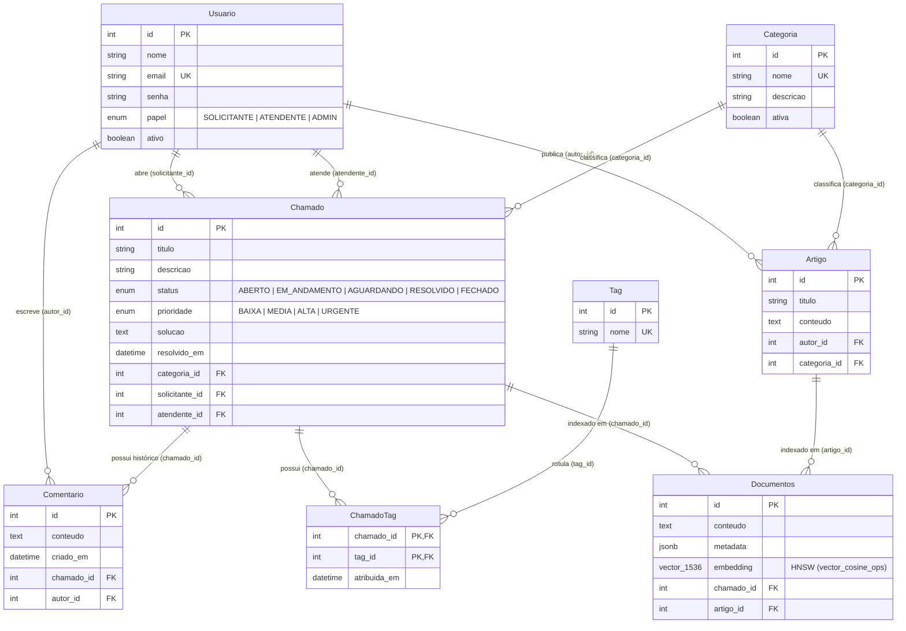

# Smart-Base Helpdesk — Base de Conhecimento Inteligente (RAG, pgvector, Prisma & Elasticsearch)

Sistema de **Helpdesk e Base de Conhecimento Inteligente** para suporte técnico de TI, combinando modelagem relacional transacional (**PostgreSQL + Prisma 7**), busca full-text (**Elasticsearch** com analisador `brazilian` e **PostgreSQL Full-Text Search `tsvector + GIN`**) e recuperação semântica com geração aumentada (**pgvector `HNSW` + Google Gemini RAG**).

---

## Sumário

1. [Arquitetura e Trilhas Implementadas](#1-arquitetura-e-trilhas-implementadas)
2. [Modelagem de Dados (Diagrama ER)](#2-modelagem-de-dados-diagrama-er)
3. [Pré-requisitos e Execução Rápida](#3-pré-requisitos-e-execução-rápida)
4. [Rotas da API REST](#4-rotas-da-api-rest)
5. [Desempenho nas Consultas (`EXPLAIN ANALYZE` e Benchmark em 5.000+ Registros)](#5-desempenho-nas-consultas-explain-analyze-e-benchmark-em-5000-registros)

---

## 1. Arquitetura e Trilhas Implementadas

- **Trilha A — Relacional e Transacional (Prisma 7 + PostgreSQL 16):**
  - Entidades `Usuario`, `Categoria`, `Chamado`, `Comentario` (1:N), `Tag` e `ChamadoTag` (N:N explícita), `Artigo` e `Documentos`.
  - Operações compostas atômicas com `prisma.$transaction` (ex.: criação de chamado + geração de embedding; resolução de chamado + registro de solução + histórico de comentário + reindexação vetorial).
- **Trilha B — Busca Textual Avançada (Elasticsearch 9 + Analisador `brazilian`):**
  - Índice `chamados` com `multi_match` ponderado (`titulo^3`, `solucao^2`, `descricao`, `categoriaNome`), tolerância a erros de digitação (`fuzziness: "AUTO"`) e destaque de trechos (`highlight`).
- **Trilha C — Busca Semântica e RAG (`pgvector` + Google Gemini):**
  - Embeddings de **1.536 dimensões** (`gemini-embedding-001`) com `taskType` diferenciado (`RETRIEVAL_DOCUMENT` na indexação e `RETRIEVAL_QUERY` na consulta).
  - Índice vetorial aproximado **HNSW** (`vector_cosine_ops`, `m = 16`, `ef_construction = 64`) na tabela `Documentos`, integrado a filtros SQL relacionais (`status`, `categoria_id`) e geração de resposta sugerida via Gemini citando os IDs das fontes (`[Chamado #id]`, `[Artigo #id]`).

---

## 2. Modelagem de Dados (Diagrama ER)



---

## 3. Pré-requisitos e Execução Rápida

### Pré-requisitos
- **Docker** e **Docker Compose** (PostgreSQL 16 com `pgvector`, pgAdmin 4 e Elasticsearch 9.5)
- **Node.js** (compatível com `tsx` / TypeScript)
- Chave da API **Google Gemini** (`GEMINI_API_KEY` no arquivo `backend/.env`)

### Passo a passo

```bash
# 1. Entrar na pasta do backend
cd backend

# 2. Subir containers (PostgreSQL + pgvector, Elasticsearch e pgAdmin)
docker-compose up -d

# 3. Instalar dependências e gerar o Prisma Client
npm install
npx prisma generate

# 4. Aplicar as migrations (inclui índices B-tree, HNSW e GIN)
npx prisma migrate deploy

# 5. Popular o banco com 5.000 chamados, 20 artigos, 50 usuários, comentários e embeddings
npm run seed

# 6. Sincronizar os 5.000 chamados com o Elasticsearch (Bulk API)
npm run sync:elastic

# 7. Executar o servidor de desenvolvimento
npm run dev

# 8. Executar o script de Benchmark e EXPLAIN ANALYZE (5.000+ registros)
npm run benchmark
# ou diretamente via Node/CommonJS:
node scripts/benchmark.js
```

---

## 4. Rotas da API REST

| Método | Rota | Descrição |
|---|---|---|
| `GET` / `POST` | `/categorias` | Lista ou cadastra categorias de TI |
| `GET` / `POST` | `/usuarios` | Lista ou cadastra usuários (com hash `bcrypt`) |
| `GET` | `/chamados` | Lista chamados com filtros (`status`, `prioridade`, `categoriaId`) e paginação |
| `GET` | `/chamados/:id` | Detalha chamado com `categoria`, `solicitante`, `atendente`, `comentarios` e `tags` |
| `POST` | `/chamados` | Cria chamado e gera seu embedding (`Documentos`) na mesma transação |
| `PATCH` | `/chamados/:id/status` | Atualiza status transacionalmente (ao resolver, exige `solucao`, cria comentário e reindexa vetor) |
| `POST` | `/chamados/:id/comentarios` | Adiciona comentário ao histórico do chamado |
| `GET` / `POST` | `/artigos` | Lista ou publica artigos da base de conhecimento |
| `GET` | `/busca/semantica?q=...&k=5` | Busca vetorial por similaridade de cosseno (`pgvector` HNSW) combinada com filtros relacionais |
| `GET` | `/busca/texto?q=...&k=5` | Busca full-text no Elasticsearch (`multi_match`, `brazilian`, `fuzziness`, `highlight`) |
| `GET` | `/busca/comparar?q=...&k=5` | Compara lado a lado `ILIKE`, `Elasticsearch` e `pgvector` para a mesma pergunta |
| `POST` | `/rag/perguntar` | Recupera top-K contextos (`Chamado`/`Artigo`) no `pgvector` e gera resposta sugerida com Gemini |

---

## 5. Desempenho nas Consultas (`EXPLAIN ANALYZE` e Benchmark em 5.000+ Registros)

Todos os testes abaixo são reproduzíveis pelo script [`backend/scripts/benchmark.ts`](file:///c:/Users/lucas/OneDrive/Documentos/Faculdade/ProjetoWillen/backend/scripts/benchmark.ts) (também executável via [`backend/scripts/benchmark.js`](file:///c:/Users/lucas/OneDrive/Documentos/Faculdade/ProjetoWillen/backend/scripts/benchmark.js) com `node scripts/benchmark.js` ou `npm --prefix backend run benchmark`).

### 5.1 Volumetria e Índices Avaliados

O benchmark valida e prepara automaticamente o ambiente garantindo **5.000+ registros** em todos os motores antes de coletar as métricas:

| Motor / Tabela | Registros Carregados | Observação |
|---|---:|---|
| **PostgreSQL — `"Chamado"`** | **5.000** | Chamados realistas de TI + massa sintética (`@faker-js/faker` `pt_BR`) |
| **PostgreSQL — `"Comentario"`** | **6.032** | Histórico de interações por chamado |
| **PostgreSQL / `pgvector` — `"Documentos"`** | **5.020** | Vetores `VECTOR(1536)` (embeddings reais Gemini + vetores unitários de backfill) |
| **Elasticsearch — índice `"chamados"`** | **5.000** | Sincronizados em lote via Bulk API com analisador `brazilian` |

#### Índices ativos no PostgreSQL (`pg_indexes`)

| Tabela | Nome do Índice | Tipo | Colunas / Expressão | Tamanho |
|---|---|---|---|---:|
| `Chamado` | `Chamado_pkey` | `B-tree (UNIQUE)` | `(id)` | `344 kB` |
| `Chamado` | `Chamado_status_idx` | `B-tree` | `(status)` | `96 kB` |
| `Chamado` | `Chamado_categoria_id_idx` | `B-tree` | `(categoria_id)` | `168 kB` |
| `Chamado` | `Chamado_status_categoria_id_idx` | `B-tree Composto` | `(status, categoria_id)` | `56 kB` |
| `Chamado` | `Chamado_solicitante_id_idx` | `B-tree` | `(solicitante_id)` | `152 kB` |
| `Chamado` | `Chamado_atendente_id_idx` | `B-tree` | `(atendente_id)` | `144 kB` |
| `Chamado` | `chamado_fts_gin_idx` | `GIN (Full-Text)` | `to_tsvector('portuguese', titulo \|\| descricao \|\| solucao)` | `792 kB` |
| `Comentario` | `Comentario_chamado_id_criado_em_idx` | `B-tree Composto` | `(chamado_id, criado_em)` | `576 kB` |
| `Documentos` | `documentos_embedding_hnsw_idx` | `HNSW (pgvector)` | `embedding vector_cosine_ops (m=16, ef_construction=64)` | `39 MB` |
| `Documentos` | `Documentos_chamado_id_idx` | `B-tree` | `(chamado_id)` | `128 kB` |
| `Documentos` | `Documentos_artigo_id_idx` | `B-tree` | `(artigo_id)` | `56 kB` |

---

### 5.2 Planos de Execução (`EXPLAIN (ANALYZE, BUFFERS)`) nas Consultas Principais

#### A) Filtros Relacionais com Índices B-tree (`categoria_id` e `status`)

**Consulta 1 — Listagem de chamados por `categoria_id`:**
```sql
EXPLAIN (ANALYZE, BUFFERS)
SELECT id, titulo, status, prioridade, categoria_id, criado_em
FROM "Chamado"
WHERE categoria_id = 24;
```
```text
Bitmap Heap Scan on "Chamado"  (cost=16.18..586.15 rows=503 width=117) (actual time=0.062..0.307 rows=503 loops=1)
  Recheck Cond: (categoria_id = 24)
  Heap Blocks: exact=278
  Buffers: shared hit=280
  ->  Bitmap Index Scan on "Chamado_categoria_id_idx"  (cost=0.00..16.05 rows=503 width=0) (actual time=0.035..0.035 rows=503 loops=1)
        Index Cond: (categoria_id = 24)
        Buffers: shared hit=2
Planning Time: 0.067 ms
Execution Time: 0.335 ms
```
- **Análise:** O planejador utiliza `Bitmap Index Scan` no índice B-tree `Chamado_categoria_id_idx` (lendo apenas 2 páginas de índice) para localizar os 503 registros da categoria em **0,335 ms**, evitando ler as 554 páginas completas da tabela.

**Consulta 2 — Agrupamento/Contagem por `status`:**
```sql
EXPLAIN (ANALYZE, BUFFERS)
SELECT status, COUNT(*)::int AS total
FROM "Chamado"
WHERE status = 'AGUARDANDO'::"StatusChamado"
GROUP BY status;
```
```text
GroupAggregate  (cost=0.28..47.79 rows=1 width=8) (actual time=0.113..0.114 rows=1 loops=1)
  Buffers: shared hit=12
  ->  Index Only Scan using "Chamado_status_categoria_id_idx" on "Chamado"  (cost=0.28..45.30 rows=992 width=4) (actual time=0.007..0.073 rows=992 loops=1)
        Index Cond: (status = 'AGUARDANDO'::"StatusChamado")
        Heap Fetches: 13
        Buffers: shared hit=12
Planning Time: 0.068 ms
Execution Time: 0.130 ms
```
- **Análise:** Como `status` é a coluna líder do índice B-tree, o PostgreSQL responde à agregação de 992 chamados via `Index Only Scan` lendo apenas **12 buffers** em **0,130 ms**.

---

#### B) Avaliação de Índices Compostos (`[status, categoriaId]` e `[chamadoId, criadoEm]`)

Nas rotas `GET /chamados` e `GET /busca/semantica`, o filtro combinado mais frequente é `WHERE status = $1 AND categoria_id = $2` (ex.: listar ou contar apenas chamados `RESOLVIDO` de uma categoria específica).

##### 1. Comparação `ANTES` vs `DEPOIS` do Índice Composto `Chamado_status_categoria_id_idx` `(status, categoria_id)`

**ANTES (apenas índices B-tree simples separados em `status` e `categoria_id`):**
```text
Aggregate  (cost=302.31..302.32 rows=1 width=4) (actual time=0.323..0.323 rows=1 loops=1)
  Buffers: shared hit=283
  ->  Bitmap Heap Scan on "Chamado"  (cost=36.38..302.05 rows=104 width=0) (actual time=0.087..0.302 rows=503 loops=1)
        Recheck Cond: ((categoria_id = 24) AND (status = 'RESOLVIDO'::"StatusChamado"))
        Heap Blocks: exact=278
        Buffers: shared hit=283
        ->  BitmapAnd  (cost=36.38..36.38 rows=104 width=0) (actual time=0.062..0.062 rows=0 loops=1)
              Buffers: shared hit=5
              ->  Bitmap Index Scan on "Chamado_categoria_id_idx"  (cost=0.00..16.05 rows=503 width=0) (actual time=0.029..0.029 rows=503 loops=1)
              ->  Bitmap Index Scan on "Chamado_status_idx"  (cost=0.00..20.02 rows=1032 width=0) (actual time=0.028..0.028 rows=1034 loops=1)
Execution Time: 0.343 ms
```

**DEPOIS (com o índice composto `Chamado_status_categoria_id_idx` em `(status, categoria_id)`):**
```text
Aggregate  (cost=10.62..10.63 rows=1 width=4) (actual time=0.071..0.072 rows=1 loops=1)
  Buffers: shared hit=8
  ->  Index Only Scan using "Chamado_status_categoria_id_idx" on "Chamado"  (cost=0.28..10.36 rows=104 width=0) (actual time=0.015..0.050 rows=503 loops=1)
        Index Cond: ((status = 'RESOLVIDO'::"StatusChamado") AND (categoria_id = 24))
        Heap Fetches: 13
        Buffers: shared hit=8
Execution Time: 0.087 ms
```

| Métrica (`WHERE status = 'RESOLVIDO' AND categoria_id = 24`) | Sem Índice Composto (`BitmapAnd`) | Com Índice Composto `[status, categoriaId]` | Ganho |
|---|---:|---:|---:|
| **Operação no Plano** | `BitmapAnd` + `Bitmap Heap Scan` | `Index Only Scan` / `Bitmap Index Scan` direto | Elimina `BitmapAnd` |
| **Custo Estimado pelo Planner (`cost`)** | `302.32` | `10.63` | **-96,5%** |
| **Páginas Lidas em Memória (`shared hit`)** | `283 buffers` | `8 buffers` | **-97,2%** |
| **Tempo de Execução no Motor (Contagem)** | `0.343 ms` | `0.087 ms` | **3,94x mais rápido** |
| **Latência P95 no Cliente (50 execuções `SELECT *`)** | `3.61 ms` | `2.74 ms` | **-24,1% no P95** |

##### 2. Índice Composto em `Comentario` (`[chamadoId, criadoEm]`)

Para carregar a linha do tempo de atendimento de um chamado (`GET /chamados/:id`), a consulta filtra por `chamado_id` e ordena por `criado_em ASC`:

```sql
EXPLAIN (ANALYZE, BUFFERS)
SELECT id, conteudo, autor_id, criado_em
FROM "Comentario"
WHERE chamado_id = 11719
ORDER BY criado_em ASC;
```
```text
Index Scan using "Comentario_chamado_id_criado_em_idx" on "Comentario"  (cost=0.28..8.30 rows=1 width=99) (actual time=0.059..0.060 rows=2 loops=1)
  Index Cond: (chamado_id = 11719)
  Buffers: shared hit=3
Planning Time: 0.100 ms
Execution Time: 0.070 ms
```
- **Análise:** O índice composto `(chamado_id, criado_em)` entrega os registros já ordenados fisicamente na folha da B-tree, eliminando qualquer nó `Sort` em memória e executando em **0,070 ms** com apenas **3 buffers**.

---

#### C) Busca Vetorial no `pgvector`: Índice `HNSW` vs `Sequential Scan` (5.020 vetores de 1.536 dimensões)

**Com índice HNSW (`documentos_embedding_hnsw_idx`) + `LEFT JOIN` relacional (`Chamado` e `Categoria`):**
```sql
EXPLAIN (ANALYZE, BUFFERS)
SELECT
  top_docs.id,
  top_docs.chamado_id,
  top_docs.similaridade,
  c.titulo AS chamado_titulo,
  c.status AS chamado_status,
  cat.nome AS categoria_nome
FROM (
  SELECT
    d.id,
    d.chamado_id,
    (1 - (d.embedding <=> '[...1536 dims...]'::vector))::FLOAT AS similaridade
  FROM "Documentos" d
  ORDER BY d.embedding <=> '[...1536 dims...]'::vector
  LIMIT 5
) top_docs
LEFT JOIN "Chamado" c ON c.id = top_docs.chamado_id
LEFT JOIN "Categoria" cat ON cat.id = c.categoria_id;
```
```text
Nested Loop Left Join  (cost=461.24..524.65 rows=5 width=137) (actual time=0.849..0.885 rows=5 loops=1)
  Buffers: shared hit=789
  ->  Nested Loop Left Join  (cost=461.10..523.87 rows=5 width=117) (actual time=0.840..0.871 rows=5 loops=1)
        Buffers: shared hit=783
        ->  Limit  (cost=460.82..482.32 rows=5 width=24) (actual time=0.838..0.871 rows=5 loops=1)
              Buffers: shared hit=774
              ->  Index Scan using documentos_embedding_hnsw_idx on "Documentos" d  (cost=460.82..22041.50 rows=5020 width=24) (actual time=0.837..0.869 rows=5 loops=1)
                    Order By: (embedding <=> '[...1536 dims...]'::vector)
                    Buffers: shared hit=774
        ->  Index Scan using "Chamado_pkey" on "Chamado" c  (cost=0.28..8.30 rows=1 width=105) (actual time=0.001..0.001 rows=1 loops=5)
              Index Cond: (id = d.chamado_id)
              Buffers: shared hit=9
  ->  Index Scan using "Categoria_pkey" on "Categoria" cat  (cost=0.14..0.15 rows=1 width=28) (actual time=0.001..0.001 rows=1 loops=5)
        Index Cond: (id = c.categoria_id)
        Buffers: shared hit=6
Planning Time: 0.253 ms
Execution Time: 0.916 ms
```

**Sem índice HNSW (`Seq Scan` em 5.020 vetores de 1.536 dimensões):**
```text
Limit  (cost=628.23..628.24 rows=5 width=28) (actual time=41.852..41.854 rows=5 loops=1)
  Buffers: shared hit=30577
  ->  Sort  (cost=628.23..640.78 rows=5020 width=28) (actual time=41.851..41.852 rows=5 loops=1)
        Sort Key: ((embedding <=> '[...1536 dims...]'::vector))
        Sort Method: top-N heapsort  Memory: 25kB
        Buffers: shared hit=30577
        ->  Seq Scan on "Documentos" d  (cost=0.00..544.85 rows=5020 width=28) (actual time=0.042..40.851 rows=5020 loops=1)
              Buffers: shared hit=30577
Execution Time: 41.871 ms
```
- **Análise:** Cada vetor `VECTOR(1536)` ocupa ~6 KB e é armazenado em páginas TOAST no PostgreSQL. O `Seq Scan` precisa ler **30.577 buffers** (~240 MB de leituras de páginas em cache) e calcular 5.020 produtos internos de 1.536 dimensões, levando **41,87 ms**. Com o índice **HNSW** (`documentos_embedding_hnsw_idx`), o grafo navegável em camadas lê apenas **774 buffers** e retorna os 5 vizinhos mais próximos já enriquecidos com `Chamado` e `Categoria` em **0,916 ms** (**45,7x mais rápido** e **39,5x menos leituras de buffer**).

---

#### D) Avaliação de Full-Text Search Nativo do PostgreSQL (`tsvector + GIN`) vs `ILIKE '%...%'`

**1. Busca com `ILIKE '%impressora%'` (`Seq Scan` obrigatório):**
```sql
EXPLAIN (ANALYZE, BUFFERS)
SELECT id, titulo, status, categoria_id, criado_em
FROM "Chamado"
WHERE titulo ILIKE '%impressora%'
   OR descricao ILIKE '%impressora%'
   OR solucao ILIKE '%impressora%'
ORDER BY criado_em DESC
LIMIT 5;
```
```text
Limit  (cost=649.90..649.92 rows=5 width=113) (actual time=18.475..18.477 rows=5 loops=1)
  Buffers: shared hit=554
  ->  Sort  (cost=649.90..651.17 rows=506 width=113) (actual time=18.474..18.475 rows=5 loops=1)
        Sort Key: criado_em DESC
        Sort Method: top-N heapsort  Memory: 27kB
        Buffers: shared hit=554
        ->  Seq Scan on "Chamado"  (cost=0.00..641.50 rows=506 width=113) (actual time=0.049..18.383 rows=498 loops=1)
              Filter: ((titulo ~~* '%impressora%'::text) OR (descricao ~~* '%impressora%'::text) OR (solucao ~~* '%impressora%'::text))
              Rows Removed by Filter: 4502
              Buffers: shared hit=554
Planning Time: 0.526 ms
Execution Time: 18.489 ms
```

**2. Busca Full-Text Nativa do PostgreSQL (`to_tsvector('portuguese', ...)` + Índice `GIN` `chamado_fts_gin_idx`):**
```sql
EXPLAIN (ANALYZE, BUFFERS)
SELECT
  id,
  titulo,
  status,
  categoria_id,
  ts_rank(
    to_tsvector('portuguese', coalesce(titulo, '') || ' ' || coalesce(descricao, '') || ' ' || coalesce(solucao, '')),
    plainto_tsquery('portuguese', 'impressora manchando papel')
  ) AS relevancia
FROM "Chamado"
WHERE to_tsvector('portuguese', coalesce(titulo, '') || ' ' || coalesce(descricao, '') || ' ' || coalesce(solucao, ''))
      @@ plainto_tsquery('portuguese', 'impressora manchando papel')
ORDER BY relevancia DESC
LIMIT 5;
```
```text
Limit  (cost=34.75..34.75 rows=1 width=109) (actual time=0.080..0.081 rows=1 loops=1)
  Buffers: shared hit=8
  ->  Sort  (cost=34.75..34.75 rows=1 width=109) (actual time=0.080..0.080 rows=1 loops=1)
        Sort Key: (ts_rank(..., '''impressor'' & ''manch'' & ''papel'''::tsquery)) DESC
        Sort Method: quicksort  Memory: 25kB
        Buffers: shared hit=8
        ->  Bitmap Heap Scan on "Chamado"  (cost=30.20..34.74 rows=1 width=109) (actual time=0.076..0.077 rows=1 loops=1)
              Recheck Cond: (to_tsvector('portuguese'::regconfig, ...) @@ '''impressor'' & ''manch'' & ''papel'''::tsquery)
              Heap Blocks: exact=1
              Buffers: shared hit=8
              ->  Bitmap Index Scan on chamado_fts_gin_idx  (cost=0.00..30.20 rows=1 width=0) (actual time=0.012..0.012 rows=1 loops=1)
                    Index Cond: (to_tsvector('portuguese'::regconfig, ...) @@ '''impressor'' & ''manch'' & ''papel'''::tsquery)
                    Buffers: shared hit=7
Planning Time: 0.154 ms
Execution Time: 0.097 ms
```
- **Análise:** Enquanto o `ILIKE '%...%'` precisa varrer sequencialmente todas as 5.000 linhas e avaliar expressões case-insensitive em 3 colunas de texto (**18,49 ms**, 554 buffers), o Full-Text Search nativo do PostgreSQL aplica *stemming* em português (`'impressor' & 'manch' & 'papel'`), consulta o índice invertido **GIN** (`chamado_fts_gin_idx`) em **0,012 ms**, lê apenas **8 buffers** no total e ordena por relevância (`ts_rank`) em **0,097 ms** (**190x mais rápido** no servidor PostgreSQL).

---

### 5.3 Benchmark Comparativo: `ILIKE` × `tsvector + GIN` × `pgvector` × `Elasticsearch` (5.000+ Registros)

Foram executadas **50 consultas por modalidade** (5 cenários reais de suporte × 10 iterações após *warm-up*) sobre a base de **5.000 chamados** e **5.020 vetores**.

#### 1. Resultados de Tempo de Resposta (em milissegundos)

| Modalidade de Busca | Tempo Interno no Motor (`EXPLAIN` / `took`) | Média Cliente (ms) | Mediana / P50 (ms) | P95 (ms) | Mín (ms) | Máx (ms) |
|---|---:|---:|---:|---:|---:|---:|
| **1. PostgreSQL Full-Text (`tsvector` + `GIN`)** | **0,10 ms** | **1,32 ms** | **1,30 ms** | **1,54 ms** | 1,08 ms | 2,43 ms |
| **2. `pgvector` SQL (`HNSW` — 5.020 vetores)** | **0,92 ms** | **45,48 ms**¹ | **45,20 ms** | **48,18 ms** | 43,43 ms | 50,84 ms |
| **3. PostgreSQL `ILIKE '%...%'` (`Seq Scan`)** | **18,49 ms** | **21,33 ms** | **21,13 ms** | **23,34 ms** | 19,84 ms | 23,68 ms |
| **4. `pgvector` Sem Índice (`Seq Scan` — 5.020 vetores)** | **41,87 ms** | — | — | — | — | — |
| **5. Elasticsearch (`multi_match` + `fuzziness` + `highlight`)** | **~4,00 ms** | **147,63 ms**² | **117,56 ms** | **295,34 ms** | 74,25 ms | 306,21 ms |
| **6. `pgvector` Fim a Fim (API Gemini + `HNSW`)** | **~400 ms (API) + 0,92 ms (DB)** | **468,36 ms** | **408,30 ms** | **650,10 ms** | 383,28 ms | 651,04 ms |

> ¹ *Nota sobre a diferença entre o tempo interno do HNSW (`0,92 ms`) e o roundtrip cliente Node.js (`~45 ms`):* o vetor de 1.536 dimensões serializado em texto (`~19 KB` por consulta) ultrapassa o MSS TCP (~1.460 bytes) no proxy de rede do Docker Desktop no Windows, sofrendo o timer de *TCP Delayed ACK* (~40–45 ms). Dentro do PostgreSQL, a varredura no índice HNSW leva **0,90–0,94 ms**.
> ² *No Elasticsearch*, o tempo inclui o transporte HTTP REST local (Docker Desktop Windows), a expansão de automatos Levenshtein (`fuzziness: "AUTO"`) em 4 campos e a geração de fragmentos de `highlight`.

#### 2. Comparação de Qualidade e Relevância por Cenário de Busca

| Cenário de Teste | Pergunta Buscada | `ILIKE` (Hits) | `tsvector + GIN` (Hits) | Elasticsearch (Hits) | `pgvector` HNSW (Hits >= 0.65) | Similaridade Top-1 (`pgvector`) | Chamado Top-1 Encontrado (`pgvector` & `Elasticsearch`) |
|---|---|---:|---:|---:|---:|---:|---|
| **1. Termos exatos / flexão verbal** | `"impressora manchando folha e atolando papel"` | 1 | 1 | 2.245 | 3 | `0.7693` | *Impressões saindo com manchas verticais pretas e papel atolando na bandeja 2* |
| **2. Erro de digitação (typo)** | `"impresora atolando papel na bandeja"` | **0** ❌ | **0** ❌ | **891** ✅ | **3** ✅ | `0.7390` | *Impressões saindo com manchas verticais pretas e papel atolando na bandeja 2* |
| **3. Linguagem natural / sinônimo** | `"nao consigo entrar no notebook porque esqueci minha credencial"` | **0** ❌ | **0** ❌ | 4.997 (ruído parcial) | **3** ✅ | `0.7481` | *Esqueci minha senha de rede e não consigo fazer login no notebook* |
| **4. Incidente técnico específico** | `"vpn forticlient trava em 40% com erro de certificado"` | 2 | 1 | 1.623 | 3 | `0.8456` | *VPN FortiClient trava em 40% com erro de certificado em home office* |
| **5. Tecnologia / código exato** | `"tela azul bitlocker pedindo chave de recuperacao de 48 digitos"` | 1 | **0** ❌ (AND estrito) | **2.219** ✅ | **3** ✅ | `0.8051` | *Notebook pedindo chave de recuperação do BitLocker de 48 dígitos ao ligar* |

#### 3. Conclusões Técnicas

1. **`ILIKE '%...%'`:** Não utiliza índices B-tree por conta do curinga inicial (`%termo%`), forçando `Seq Scan` (~18,5 ms para 5.000 linhas, crescendo linearmente $O(N)$) e falhando completamente quando há erros de digitação (`"impresora"`) ou sinônimos (`"credencial"` vs `"senha"`).
2. **Full-Text Nativo do PostgreSQL (`tsvector + GIN`):** É a opção mais rápida de todas (**0,10 ms** no motor, **1,30 ms** no cliente) e resolve plurais/conjugações em português via *stemming*, sem exigir infraestrutura externa. Porém, como `plainto_tsquery` aplica conjunção lógica (`AND`) estrita entre todos os radicais e não possui *fuzziness* nativo, retorna 0 resultados se o usuário cometer um erro de digitação ou adicionar palavras ausentes no documento.
3. **Elasticsearch (`multi_match` + `brazilian` + `fuzziness: AUTO`):** Excelente para busca textual tolerante a falhas ortográficas (`"impresora"` recupera o chamado correto no Top-1) e destaca os termos encontrados (`<mark>`), mas em perguntas longas em linguagem natural com `operator: "or"` pode trazer milhares de documentos com interseção parcial de palavras comuns.
4. **Busca Semântica com `pgvector` (`HNSW`):** Une a velocidade sub-milissegundo no banco (**0,92 ms** com `Index Scan` em `documentos_embedding_hnsw_idx` + `LEFT JOIN` relacional no mesmo PostgreSQL) à compreensão de significado do modelo `gemini-embedding-001`. Recupera com alta precisão (`0.73` a `0.85` de similaridade) tanto perguntas com erros de digitação quanto descrições por sinônimos (`"esqueci minha credencial"` → encontra `"Esqueci minha senha de rede"`), viabilizando o pipeline completo de **RAG**.

